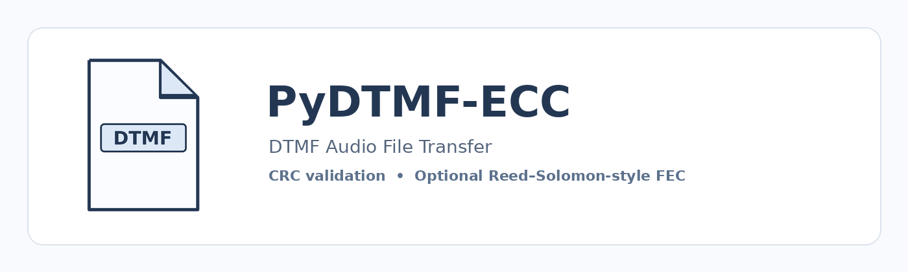

<div align="center">
  
</div>

# PyDTMF-ECC

**Transfer text and files through sound using DTMF packets, synchronization pulses, CRC checks, and optional forward error correction (FEC).**

[English](#english) · [한국어](#한국어)

<a id="english"></a>
## English

PyDTMF-ECC is a Windows desktop application that sends and receives text or files as audio. It uses DTMF tone pairs for packet data, a separate 1850 Hz synchronization tone, CRC-16 packet validation, and optional Reed–Solomon-style error correction to recover missing or CRC-invalid data blocks.

### Features

- **Live audio transfer:** transmit through a speaker and receive through a microphone.
- **Smooth live waterfall:** incremental spectrogram updates at up to 25 FPS, with a rolling 12-second view and a fixed canvas grid to reduce redraw stutter.
- **Live receive view:** input level, packet states, recovered-message preview, and receive log.
- **Automatic receive reset:** detected new transmissions clear stale receive state while repeat passes of the same transfer are merged when the packet timing indicates a retry.
- **WAV workflow:** encode data to WAV and decode saved WAV audio.
- **Automatic compression:** chooses a supported representation before audio transmission when it reduces the payload.
- **Packet integrity:** CRC-16/CCITT-FALSE checks each packet.
- **Optional FEC:** preset recovery modes and a custom parity percentage.
- **Retransmission support:** repeat a transmission or resend selected missing blocks.
- **Bilingual UI:** English is selected on first launch; Korean is available from the language selector.
- **Single-file Windows build:** the build script creates `PyDTMF-ECC.exe` next to the script, not in a `dist` folder.

### Error-correction settings

| Setting | Configuration | Notes |
|---|---|---|
| Mode 0 | CRC only | Detects bad packets; no parity-based recovery. |
| Mode 1 | 10% parity overhead | Each group has up to 100 data blocks. The estimated maximum recovery capacity is shown in the app for the selected payload. |
| Mode 2 | 20% parity overhead | Same grouping, with stronger protection and more extra packets. |
| Mode 3 | 30% parity overhead | Same grouping, with the strongest preset protection. |
| Custom | 0–100% parity overhead | Select any integer percentage. `0%` uses the CRC-only wire format. |

Parity is calculated for each group of up to 100 data blocks and rounded up for a partial final group. The app shows the estimated maximum number of recoverable data blocks, the selected parity percentage, and the actual parity-block count for the current payload, assuming all needed parity packets arrive correctly. This is an upper bound: each group has its own limit, so loss concentration and loss of parity packets can lower the real recovery capacity. FEC adds extra packets, so stronger protection takes longer to transmit. The receiver hides internal FEC header/parity packets from the ordinary data-block list and marks recovered data blocks as recovered.

### Transfer speed

| Preset | Tone duration | Gap |
|---|---:|---:|
| Slow | 50 ms | 20 ms |
| Normal | 30 ms | 10 ms |
| Fast | 20 ms | 10 ms |

Choose the **same speed on both devices**. Start with Slow or Normal for speaker-to-microphone transfers. Fast mode is more sensitive to speaker, microphone, distance, room reflections, audio processing, and background noise.

### Requirements

- Windows 10/11, 64-bit (the included builder targets 64-bit Python).
- Python 3.11, 3.12, or 3.13, 64-bit, **only on the PC that builds the EXE**.
- Internet access during the first build to install the Python packages listed in `requirements-build.txt`.
- A working speaker/output device and microphone/input device for live acoustic transfer.

### Build the Windows executable

1. Download or clone this repository and extract it to a normal local folder.
2. Install 64-bit Python 3.12 from [python.org](https://www.python.org/downloads/windows/). Enable **Add Python to PATH** in the installer.
3. Double-click `BUILD_EXE_WINDOWS.bat` and wait for it to finish.
4. The result is `PyDTMF-ECC.exe` in the project folder. Temporary build directories and the local build virtual environment are removed after a successful build.
5. To distribute the app, copy `PyDTMF-ECC.exe` and provide the applicable third-party notices. The target PC does not need Python installed.

If the build fails, the script leaves `BUILD_FAILED.txt` in the project folder. It is only created for a failed build; it is removed after a successful build. Include that file when reporting a build issue.

### Run from source

Open a terminal in the repository folder and run:

```bat
py -3.12 -m venv .venv
.venv\Scripts\python.exe -m pip install -r requirements-build.txt
.venv\Scripts\python.exe pydtmf_ecc_entry.py
```

### First-time transfer checklist

1. Start the app on both devices.
2. On the receiving device, choose the correct microphone and start receiving.
3. On the sending device, enter text or choose a file, select the recovery mode, and press Send.
4. Use the same speed preset on both devices. The receiving side detects the selected FEC format from the transfer header.
5. If reception is unreliable, lower the speed, increase microphone input volume without clipping, reduce the distance, and avoid loud background noise.
6. Allow microphone access for desktop apps in Windows Privacy settings if prompted.

### Protocol and compatibility notes

- Audio payload packets contain 16 data bytes plus packet-number and CRC symbols. Internal headers and FEC parity packets are used when FEC is enabled.
- Both devices should use the same PyDTMF-ECC protocol version. FEC-enabled sends require a receiver that supports the current FEC header format.
- **The audio transmission is not encrypted or authenticated.** Do not use it to send secrets or sensitive files over an environment where others may record the audio.
- Acoustic performance depends on the actual audio hardware and environment. Software/synthetic-signal tests do not guarantee recovery in every physical speaker/microphone setup.

### Repository layout

```text
PyDTMF-ECC/
├── README.md
├── BUILD_EXE_WINDOWS.bat
├── requirements-build.txt
├── version_info.txt
├── pydtmf_ecc_entry.py
├── pydtmf_ecc.ico
├── audio_file_transfer.py
├── audio_file_transfer_live.py
├── audio_file_transfer_gui.py
├── THIRD_PARTY_NOTICES.md
└── assets/
    ├── pydtmf_ecc_banner.png
    └── pydtmf_ecc_icon.png
```

### License

No project-level `LICENSE` file is included yet. Until the maintainer selects and adds a license, permissions to reuse, modify, or redistribute this project's source code are not explicitly granted. See `THIRD_PARTY_NOTICES.md` for third-party package license information.

---

<a id="한국어"></a>
## 한국어

PyDTMF-ECC는 DTMF 음향 패킷으로 텍스트와 파일을 송수신하는 Windows 데스크톱 프로그램입니다. 데이터는 DTMF 톤으로 전송하고, 별도의 1850Hz 동기화음과 CRC-16 검사, 선택형 리드-솔로몬 계열 오류 정정(FEC)을 이용해 누락되거나 CRC 검사에 실패한 데이터 블록을 복원합니다.

### 주요 기능

- **실시간 음향 전송:** 스피커로 송신하고 마이크로 수신합니다.
- **부드러운 실시간 워터폴:** 새로 들어온 오디오 샘플만 분석하고 최대 25FPS로 갱신하며, 12초 롤링 표시와 고정 캔버스 눈금을 사용해 화면 끊김을 줄입니다.
- **실시간 수신 화면:** 입력 레벨, 블록 상태, 수신 메시지 미리보기, 수신 로그를 표시합니다.
- **WAV 파일 처리:** 데이터를 WAV로 인코딩하고 저장된 WAV를 디코딩할 수 있습니다.
- **자동 압축:** 압축으로 전송 데이터가 줄어들면 지원하는 표현 방식 중 더 작은 결과를 선택합니다.
- **패킷 무결성 검사:** 각 패킷에 CRC-16/CCITT-FALSE를 적용합니다.
- **선택형 FEC:** 고정 복구 모드와 사용자 지정 패리티 비율을 제공합니다.
- **재전송 지원:** 전체 전송을 반복하거나 누락된 블록을 선택해 재전송할 수 있습니다.
- **한국어·영어 UI:** 처음 실행할 때 영어로 시작하며 언어 선택 메뉴에서 한국어로 바꿀 수 있습니다.
- **단일 파일 Windows 빌드:** 빌드 스크립트가 `dist` 폴더가 아닌 스크립트와 같은 폴더에 `PyDTMF-ECC.exe`를 생성합니다.

### 오류 복구 설정

| 설정 | 구성 | 설명 |
|---|---|---|
| Mode 0 | CRC만 사용 | 손상된 패킷을 검출하지만 패리티 기반 복구는 하지 않습니다. |
| Mode 1 | 패리티 오버헤드 10% | 그룹마다 최대 100개 데이터 블록을 사용합니다. 선택한 전송 내용에 대한 최대 복구 예상치가 프로그램에 표시됩니다. |
| Mode 2 | 패리티 오버헤드 20% | 같은 그룹 구조에서 보호 수준과 추가 패킷 수가 늘어납니다. |
| Mode 3 | 패리티 오버헤드 30% | 기본 모드 중 가장 강한 보호를 제공합니다. |
| Custom | 패리티 오버헤드 0~100% | 정수 비율을 자유롭게 선택합니다. `0%`는 CRC 전용 와이어 형식을 사용합니다. |

패리티는 최대 100개의 데이터 블록으로 이루어진 그룹마다 계산하고, 마지막의 불완전한 그룹은 올림 처리합니다. 프로그램은 현재 전송 내용의 패리티 비율과 복구용 블록 수, 이론상 최대 복구 가능한 데이터 블록 수를 표시합니다. 필요한 패리티 패킷이 모두 정상 수신된다는 가정의 상한값입니다. 그룹마다 별도의 복구 한도가 있고 패리티 패킷도 손실될 수 있으므로 실제 복구량은 더 작을 수 있습니다. FEC를 사용하면 추가 패킷을 전송하므로 보호 수준이 높을수록 전송 시간이 길어집니다. 내부 FEC 헤더와 패리티 패킷은 일반 데이터 블록 목록에서 숨기고, 복원이 완료된 실제 데이터 블록에는 복구 상태를 표시합니다.

### 전송 속도

| 프리셋 | 톤 길이 | 공백 |
|---|---:|---:|
| 느림 | 50ms | 20ms |
| 보통 | 30ms | 10ms |
| 빠름 | 20ms | 10ms |

송신기와 수신기에서 **같은 속도를 선택해야 합니다.** 스피커에서 마이크로 전송한다면 느림 또는 보통으로 시작하세요. 빠름 모드는 스피커·마이크 성능, 거리, 실내 반사음, 운영체제의 오디오 처리, 주변 소음에 더 민감합니다.

### 요구 사항

- Windows 10/11 64비트(포함된 빌드 스크립트는 64비트 Python을 사용합니다).
- EXE를 빌드하는 PC에만 Python 3.11, 3.12 또는 3.13 64비트가 필요합니다.
- 첫 빌드에서 `requirements-build.txt`의 라이브러리를 설치할 인터넷 연결이 필요합니다.
- 실제 음향 전송에는 정상 작동하는 스피커/출력 장치와 마이크/입력 장치가 필요합니다.

### Windows EXE 만들기

1. 이 저장소를 다운로드하거나 복제한 뒤 일반 로컬 폴더에 압축을 풉니다.
2. [python.org](https://www.python.org/downloads/windows/)에서 Python 3.12 64비트를 설치합니다. 설치 중 **Add Python to PATH** 옵션을 선택하세요.
3. `BUILD_EXE_WINDOWS.bat`을 더블클릭하고 작업이 끝날 때까지 기다립니다.
4. 결과물은 프로젝트 폴더 안의 `PyDTMF-ECC.exe`입니다. 빌드에 성공하면 임시 빌드 폴더와 빌드용 가상환경을 삭제합니다.
5. 배포할 때는 `PyDTMF-ECC.exe`와 해당되는 제3자 라이선스 고지를 함께 제공하세요. 실행 대상 PC에는 Python을 설치할 필요가 없습니다.

빌드가 실패하면 프로젝트 폴더에 `BUILD_FAILED.txt`가 남습니다. 이 파일은 빌드 실패 때만 생성되며 빌드가 성공하면 삭제됩니다. 빌드 오류를 문의할 때 이 파일을 함께 보내 주세요.

### 소스 코드로 실행하기

저장소 폴더에서 터미널을 열고 다음 명령을 실행합니다.

```bat
py -3.12 -m venv .venv
.venv\Scripts\python.exe -m pip install -r requirements-build.txt
.venv\Scripts\python.exe pydtmf_ecc_entry.py
```

### 처음 사용할 때 확인할 사항

1. 두 장치에서 프로그램을 실행합니다.
2. 수신 장치에서 올바른 마이크를 선택하고 수신을 시작합니다.
3. 송신 장치에서 텍스트를 입력하거나 파일을 선택하고 복구 모드를 정한 뒤 송신을 누릅니다.
4. 두 장치에서 같은 속도 프리셋을 사용합니다. 수신기는 전송 헤더로 FEC 형식을 감지합니다.
5. 수신이 불안정하면 속도를 낮추고, 마이크 입력 볼륨을 클리핑이 발생하지 않는 범위에서 높이고, 장치 사이 거리를 줄이고, 큰 주변 소음을 피하세요.
6. Windows에서 마이크 권한을 요청하면 개인정보 설정에서 데스크톱 앱의 마이크 접근을 허용하세요.

### 프로토콜 및 호환성 안내

- 오디오 데이터 패킷 하나는 데이터 16바이트와 패킷 번호 및 CRC 심볼을 포함합니다. FEC를 켜면 내부 헤더와 복구용 패리티 패킷도 사용합니다.
- 송신기와 수신기는 같은 PyDTMF-ECC 프로토콜 버전을 사용하는 것이 좋습니다. FEC 송신을 받으려면 현재 FEC 헤더 형식을 지원하는 수신기가 필요합니다.
- **음향 전송은 암호화되거나 송신자가 인증되는 방식이 아닙니다.** 다른 사람이 소리를 녹음할 수 있는 환경에서 비밀 또는 민감한 파일을 전송하지 마세요.
- 실제 음향 성능은 장치와 환경에 따라 달라집니다. 소프트웨어/합성 신호 테스트가 모든 실제 스피커·마이크 조합에서의 복구를 보장하지는 않습니다.

### 저장소 구성

```text
PyDTMF-ECC/
├── README.md
├── BUILD_EXE_WINDOWS.bat
├── requirements-build.txt
├── version_info.txt
├── pydtmf_ecc_entry.py
├── pydtmf_ecc.ico
├── audio_file_transfer.py
├── audio_file_transfer_live.py
├── audio_file_transfer_gui.py
├── THIRD_PARTY_NOTICES.md
└── assets/
    ├── pydtmf_ecc_banner.png
    └── pydtmf_ecc_icon.png
```

### 라이선스

현재 프로젝트 수준의 `LICENSE` 파일은 포함되어 있지 않습니다. 관리자가 라이선스를 선택해 추가하기 전까지는 이 프로젝트 소스의 재사용·수정·재배포 권한이 명시적으로 부여된 것으로 간주하면 안 됩니다. 제3자 패키지의 라이선스 정보는 `THIRD_PARTY_NOTICES.md`를 확인하세요.
